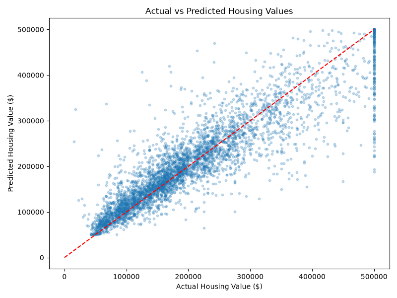
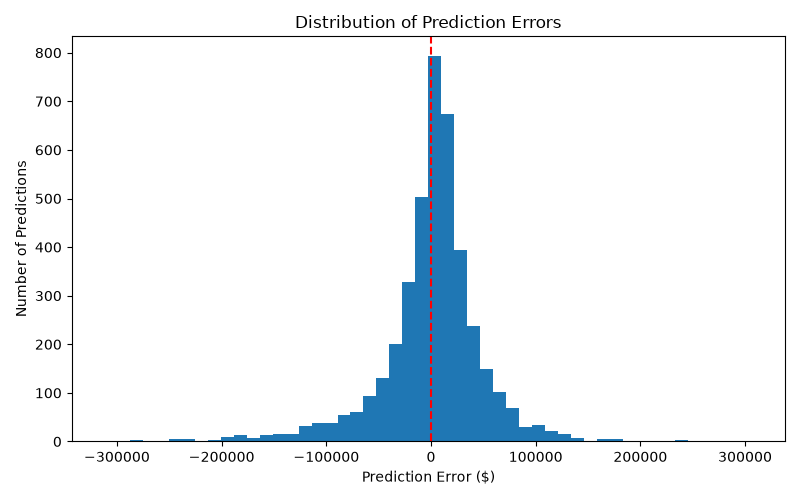
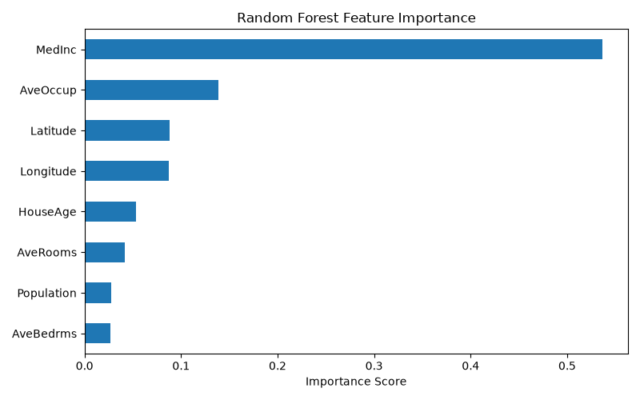

# 🏠 AI-Powered House Price Prediction System

An end-to-end Machine Learning project developed using **Python, Scikit-learn, Random Forest Regression, and Streamlit** to predict median housing values from historical California housing data.

The project covers data exploration, model training, evaluation, visualization, and integration with an interactive web application.

## 🚀 Features

- Housing value prediction using Random Forest Regression
- Interactive Streamlit web application
- Exploratory Data Analysis (EDA)
- Feature importance analysis
- Actual vs. predicted value visualization
- Prediction error distribution analysis
- Trained model persistence using Joblib

## 🛠️ Technologies Used

- **Language:** Python
- **Machine Learning:** Scikit-learn, Random Forest
- **Data Processing:** Pandas, NumPy
- **Visualization:** Matplotlib
- **Web Application:** Streamlit
- **Model Serialization:** Joblib

## 📊 Dataset

This project uses the California Housing dataset available through Scikit-learn.

- **Records:** 20,640
- **Input Features:** 8
- **Target:** Median housing value

The input features include median income, house age, average rooms, average bedrooms, population, average occupancy, latitude, and longitude.

The dataset describes housing districts rather than individual properties.

## 🧠 Machine Learning Methodology

1. Loaded and explored the dataset using Pandas.
2. Checked the dataset for missing values.
3. Separated input features and target values.
4. Applied an 80/20 random train-test split.
5. Trained a Random Forest Regressor.
6. Evaluated predictions using MAE and R².
7. Analyzed prediction errors and feature importance.
8. Saved the trained model using Joblib.
9. Integrated the model into a Streamlit web application.

## 📈 Model Performance

The trained Random Forest model achieved the following results on the held-out test set:

| Evaluation Metric | Result |
|---|---|
| R² Score | 0.8004 |
| Mean Absolute Error | $33,312.35 |
| Validation Method | 80/20 Train-Test Split |

These metrics describe performance on the project's held-out test dataset and do not guarantee accuracy for individual properties.

## 📉 Model Evaluation Visualizations

### Actual vs. Predicted Housing Values



### Prediction Error Distribution



### Feature Importance



## 💻 Installation and Setup

### 1. Clone the repository

```bash
git clone https://github.com/MalikMahadAsif/AI-House-Price-Predictor.git
cd AI-House-Price-Predictor
```

### 2. Create a virtual environment

```bash
python -m venv .venv
```

### 3. Install dependencies

```bash
.venv/Scripts/python.exe -m pip install -r requirements.txt
```

The command above is intended for Windows.

### 4. Train the model

```bash
.venv/Scripts/python.exe train_model.py
```

This creates the trained model inside the `models` directory.

### 5. Run the Streamlit application

```bash
.venv/Scripts/python.exe -m streamlit run app.py
```

Open the local URL displayed in your terminal, typically:

http://localhost:8501

An internet connection may be required the first time the California Housing dataset is downloaded.

## 📁 Project Structure

```text
AI-House-Price-Predictor/
├── app.py
├── train_model.py
├── evaluate_model.py
├── explore_data.py
├── requirements.txt
├── README.md
├── .gitignore
├── actual_vs_predicted.png
├── prediction_errors.png
├── feature_importance.png
└── models/
    └── house_price_model.pkl   # Generated locally
```

The trained model is generated by running `train_model.py` and is not currently included in this repository.

## 🔮 Future Improvements

- Compare Random Forest with other regression algorithms
- Introduce cross-validation and hyperparameter tuning
- Improve input validation
- Develop a React frontend with a FastAPI backend
- Deploy the application publicly

## 👨‍💻 Developer

**Malik Mahad Asif**

Computer Engineering Graduate — FAST-NUCES, Lahore

**GitHub:** https://github.com/MalikMahadAsif

**Portfolio:** https://malikmahadasif.github.io/

## ⚠️ Disclaimer

This project is intended for educational purposes. Predictions are estimates of California district-level median housing values, not professional property appraisals.
